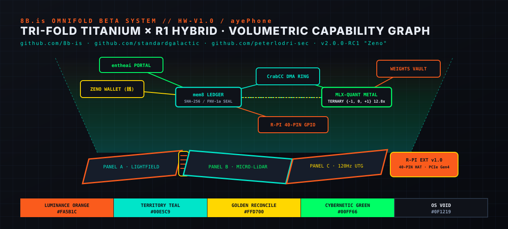

<div align="center">
  
  <h1>8B.is Omnifold (<code>ayePhone</code>) 🚀</h1>
  <p><strong>Tri-Fold Aerospace Titanium × R1 Hybrid Cybernetic Terminal · 64K Volumetric Light-Field · Vaked Capability Graph · MLX-QUANT Ternary Metal · ZENO Autonomous Wallet</strong></p>
  <p>
    <sub>v2.0.0-RC1 "Zeno" · Creators: <a href="https://8b.is">https://8b.is</a> · Crew: Hue · Aye · Taisha · Omni · Family: Alexandra (<code>*</code>) · Chris (<code>△</code>) · Nate · Peter</sub>
  </p>
  <p>
    <a href="docs/ARCHITECTURE_E2E.md"></a>
    <a href="docs/HARDWARE_SPEC.md"></a>
    <a href="docs/rc1/capability-graph.md"></a>
    <a href="docs/rc1/zero-cost-audit.md"></a>
    <a href="crates/omnifold-core"></a>
  </p>
</div>

---

## 1. System Overview

The **8B.is Omnifold (`ayePhone`)** is a cybernetic handheld and modular workbench bridging **multi-modal spatial computing**, **low-level capability-graph security**, **autonomous agent swarms**, and **bare-metal ternary model inference**:

1. **Physical Tri-Fold Chassis (`HW-V1.0`)**: Grade 5 Aerospace Titanium Z-fold frame paired with the **v1.0 Teenage Engineering / Rabbit r1 Hybrid** layer in matte **Luminance Orange (`#FA5B1C`)**, smoked semi-crystalline PEI windows, a piezo-actuated haptic rotary scroll wheel, a 360° rotative ocular camera, and active micro-piezo Loop Heat Pipe (LHP) thermal bridges.
2. **Volumetric Light-Field Display**: 120 Hz VRR Ultra-Thin Glass (UTG) + phase-plate holographic emitter projecting **64K (65,536)** effective spatial points up to **45 cm** above the display (160° cone, 3,200 nits) in **Standard Galactic volumetric glyphs**.
3. **Raspberry Pi 40-Pin Universal Plug/IO Extender (`R-PI EXT v1.0`)**: Recessed dust-gasketed spring-pin pogo rails + Neodymium N52 magnetic alignment + dual micro-solenoid slide-cam locks, 2-lane PCIe Gen 4 SerDes bridge, bidirectional 1.8V ↔ 3.3V auto-sensing level shifters with 3.6V over-voltage clamps, and mandatory I3C hot-plug capability arbitration.
4. **Sovereign Software Stack (`ayeOS` · `8B.is Engine` · `Vaked` · `entheai` · `CrabCC` · `MLX-QUANT` · `ZENO`)**:
   - **`ayeOS`**: Deterministic `LINOSV`-seeded ternary OS layer bridging Mach (`aarch64-apple-darwin`) and HarmonyOS Distributed Soft Bus over `MEMNET` (`:9876`) and Tailscale Aperture.
   - **`8B.is Engine`**: Concurrent micro-agent hyper-visor (`crates/admissibility`, `crates/spherepop`, `crates/ternary`) orchestrating AgentField, OpenFang, and NullClaw swarms over NATS JetStream.
   - **`Vaked Runtime` & `mem8` Continuity Ledger**: Zero-allocation hash-verified capability graph where `ZenoWallet` and `entheai` can trigger local inference (`INFER::trigger`) without any path to read model weights (`WEIGHTS::read`).
   - **`entheai` & `CrabCC`**: Sovereign coding portal feeding symbol slices into Apple Silicon Unified Memory through a zero-allocation fixed-slot DMA ring buffer.
   - **`MLX-QUANT` v2.0.0-RC1 "Zeno"**: Direct-to-Metal fused ternary `{ -1, 0, +1 }` (12.80× compression) and mixed 2/3/4-bit executor.
   - **`ZENO` (銭・禅・善)**: Default autonomous financial layer, Kintsugi double-entry ledger, and 5-way **Sanpo Yoshi** family/crew split (`*` Mom Alexandra 15%, `△` Dad Chris 15%, 8b-is Crew 40%, Agent Compute Escrow 20%, Universal Public Treasury 10%).

---

## 2. Industrial Design & Hardware Blueprints

| v1.0 [R1 Hybrid] Industrial Showcase | 3D Isometric Cutaway & Exploded Blueprint |
| :---: | :---: |
|  |  |

---

## 3. Master Architecture & RC1 Deliverable Index

| Document | Scope |
| :--- | :--- |
| [`docs/ARCHITECTURE_E2E.md`](docs/ARCHITECTURE_E2E.md) | Full E2E system & software stack (`ayeOS`, `8B.is Engine`, `Vaked`, `mem8`, `entheai`, `CrabCC`, `MLX-QUANT`, `ZENO`) |
| [`docs/HARDWARE_SPEC.md`](docs/HARDWARE_SPEC.md) | Tri-Fold Titanium & R1 Hybrid mechanics, 64K light-field display, piezo rotary wheel, and Bio-Harmonic sensors |
| [`docs/UNIVERSAL_IO_RPI.md`](docs/UNIVERSAL_IO_RPI.md) | Raspberry Pi 40-pin extender (`R-PI EXT v1.0`), PCIe Gen 4 SerDes hub, 1.8V↔3.3V level shifters, I3C hot-plug arbitration |
| [`docs/ZENO_WALLET_MCP_ACP.md`](docs/ZENO_WALLET_MCP_ACP.md) | Zeno autonomous capability wallet, Kintsugi ledger, Sanpo Yoshi split, and MCP/ACP tool-calls |
| [`docs/rc1/zero-cost-audit.md`](docs/rc1/zero-cost-audit.md) | **RC1 Deliverable 1**: Symbol resolution, zero-alloc DMA ring, and static bump-heap audit (Measured `●` / Designed `●` / Unverified `○`) |
| [`docs/rc1/capability-graph.md`](docs/rc1/capability-graph.md) | **RC1 Deliverable 2**: 8-node, 12-edge Vaked capability graph configuration & weight-isolation proof |
| [`docs/rc1/build-matrix.md`](docs/rc1/build-matrix.md) | **RC1 Deliverable 3**: Compiler flags & verification matrix for `aarch64-apple-darwin` (M1/M3 Pro & Max) |
| [`docs/rc1/release-notes.md`](docs/rc1/release-notes.md) | **RC1 Deliverable 4**: RC1 changelog in Ghostty cybernetic layout & Standard Galactic volumetric spacing |
| [`terminal/`](terminal/) | Ready-to-load `ghostty.conf` (with macOS FKA spacebar guard), `kitty.conf`, and `tmux.conf` in the 5-color Omnifold palette |
| [`index.html`](index.html) | Interactive web blueprint & live Vaked capability-graph trace simulator |

---

## 4. Run & Verify the Executable Rust Specification

This repository ships a zero-dependency Rust workspace (`crates/omnifold-core` and `crates/omnifold-cli`) that models and verifies the capability graph, `mem8` continuity ledger, zero-alloc `CrabCC` DMA ring, Bio-Harmonic 432 Hz decoder, R-Pi 40-pin I3C hot-plug arbiter, and Zeno Sanpo Yoshi wallet:

```bash
cargo fmt --check
cargo clippy --all-targets -- -D warnings
cargo test
cargo run --bin ayephone
```

### Verified CLI Output (`cargo run --bin ayephone`)

```text
┌─ 8 B . i s   O M N I F O L D   //   a y e P h o n e   v 2 . 0 . 0 - R C 1 ─┐
│  S T A N D A R D   G A L A C T I C   ·   V A K E D   ·   M L X - Q U A N T │
│  { - 1 ,   0 ,   + 1 }   ·   m e m 8   ·   Z E N O   ·   e n t h e a i     │
└────────────────────────────────────────────────────────────────────────────┘

▌ 1 .   Z E R O - C O S T   &   D M A   R I N G   A U D I T
  ● DMA slot #01 <- crabcc::worktree::entheai_root     digest=0x537917712ed62de9
  ● DMA slot #02 <- mlx_quant::ternary::qmm_t_fused    digest=0xffb5baaed73175ef
  ● DMA slot #03 <- ayeos::memnet::linosv_seed         digest=0x9aebf3b5e070d97f
  ● DMA slot #04 <- zeno::kintsugi::sanpo_yoshi_seal   digest=0x3feb2b6ee55928e7
  ● Ring state: 4/8 slots occupied · zero heap allocations · rolling=0xba722e024d40d09a

▌ 2 .   V A K E D   C A P A B I L I T Y   G R A P H   &   Z E N O   W A L L E T
  ● Nodes: 8 · Edges: 12 · Weight isolation verified: true
  ● Sanpo Yoshi (10,000 JPY): Mom(*)=1500000000 µJPY · Dad(△)=1500000000 µJPY · Crew=4000000000 µJPY · Agent=2000000000 µJPY · Treasury=1000000000 µJPY
  ● Wallet -> mem8 -> CrabCC -> PolarQueue -> MLX-QUANT: 6 edges verified · head_seal=0xee7392ccf0adf6e7
  ● mem8 continuity chain valid: true

▌ 3 .   B I O - H A R M O N I C   &   R - P I   U N I V E R S A L   I O
  ● Posture CompactPocket        -> UTG  24 Hz · Holo ceiling   0 mm ·     0 spatial pts
  ● Posture R1HybridZFold        -> UTG  90 Hz · Holo ceiling 300 mm · 32768 spatial pts
  ● Posture FullWorkbenchTriFold -> UTG 120 Hz · Holo ceiling 450 mm · 65536 spatial pts
  ● 432 Hz AirGesture::NodeFork -> op=ForkWorktree · depth=340 mm · phase_locked=true · 3020 nits · hash=0xdd303ee7167767de
  ● R1 Rotary Wheel [CodeDiffScrub]: piezo detent=420 mN · 24 steps/rev
  ● R-PI EXT v1.0 40-pin HAT: I3C handshake seal=0x94acb0135847ec3d · LHP shunt=true · Pin 11=Soc1v8ToHat3v3

▌ 4 .   O M N I F O L D   B E T A   I D E N T I T Y   P A L E T T E
  ■ LUMINANCE ORANGE   #FA5B1C  —  Primary hardware chassis & R-Pi extender
  ■ TERRITORY TEAL     #00E5C9  —  Micro-LiDAR sensors & volumetric light-field UI
  ■ GOLDEN RECONCILE   #FFD700  —  ZENO Kintsugi financial ledger & capability seals
  ■ CYBERNETIC GREEN   #00FF66  —  ayeOS, 8B.is Engine, and entheai quantum worktrees
  ■ OS VOID            #0F1219  —  UTG backdrop, Ghostty terminal void & titanium frame
```

---

## 5. Constellation Lineage

- [`8b-is/MLX-QUANT`](https://github.com/8b-is/MLX-QUANT) — Fused ternary `{ -1, 0, +1 }` Metal 4 kernels (12.80× compression) & RC1 "Zeno" release line.
- [`8b-is/ayeos`](https://github.com/8b-is/ayeos) — Deterministic `LINOSV` ternary inference daemon & `MEMNET` context protocol.
- [`8b-is/8b-is-engine`](https://github.com/8b-is/8b-is-engine) — Admissibility (`CT-000`), Spherepop (`crates/spherepop`), ternary model lane, and world-core.
- [`8b-is/zeno`](https://github.com/8b-is/zeno) (`zeno.vaked.dev`) — Kintsugi double-entry neo-bank, `ZKP1` incremental chain kompression (`zeno × wupz`), and Stripe/ACP/MCP gateway.
- [`8b-is/kitty`](https://github.com/8b-is/kitty) & Ghostty — GPU terminal cockpit surfaces.
- [`standardgalactic`](https://github.com/standardgalactic) — Central Theorem, Spherepop, and Standard Galactic volumetric glyph grammar.

## 6. License

MIT License. Built with love by the **8b-is** crew (Hue, Aye, Taisha, Omni) and family (Alexandra `*`, Chris `△`, Nate, Peter).

*0 + 1 · folded back from infinity till forever · 8b.is / vaked.dev*
