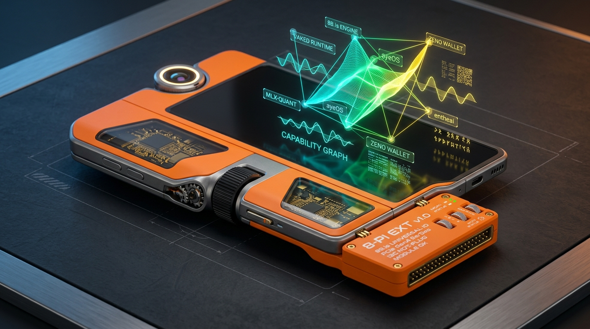
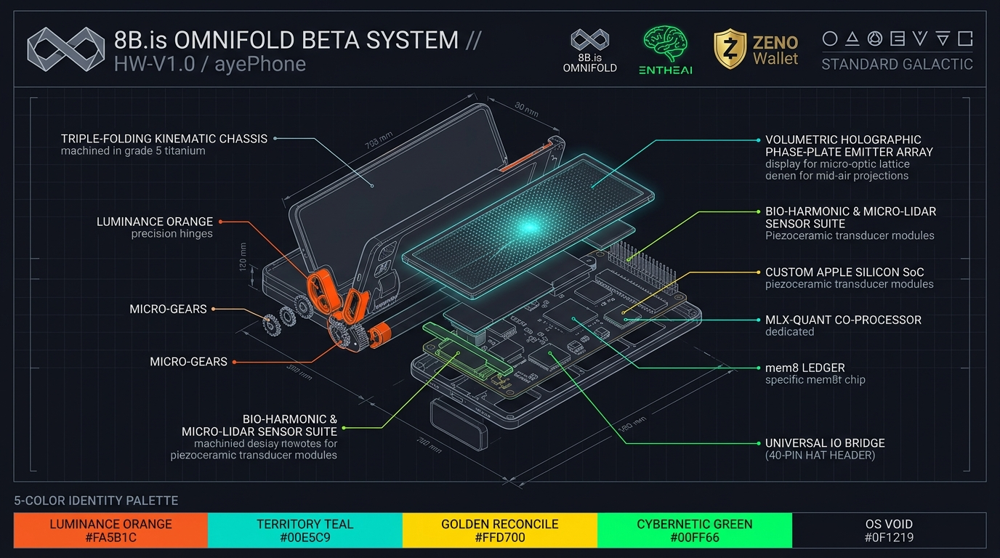

# 8B.is Omnifold (`ayePhone`) — Hardware & Industrial Design Specification

*Hardware Revision: `HW-V1.0` (Titanium Pro & v1.0 Rabbit r1 / Teenage Engineering Hybrid Edition)*

---

## 1. Physical Chassis & Tri-Fold Kinematics

| Subsystem | Specification | Engineering Detail |
| :--- | :--- | :--- |
| **Primary Frame** | Grade 5 Aerospace Titanium (`Ti-6Al-4V`) | Ceramic bead-blasted matte rail finish with carbon-infused polymer stress dissipators |
| **v1.0 R1 Hybrid Shell** | Matte **Luminance Orange (`#FA5B1C`)** + Selective Smoked PEI | High-visibility Teenage Engineering / Rabbit r1 tactile composite with smoked semi-crystalline polyetherimide (PEI) / tinted sapphire windows over internal inductors and status OLEDs |
| **Hinge Architecture** | Dual-Axis Gear-Synchronized Kinematic Clutch | Precision micro-gears with liquid metal seals enabling smooth 180° inward + 180° outward Z-fold articulation (`CompactPocket` ↔ `R1HybridZFold` ↔ `FullWorkbenchTriFold`) |
| **Stacking Geometry** | 45° Chamfered Perimeter Guide Rails | Self-aligns modular backpacks and hardware HAT extenders in low-light bench environments |
| **Thermal Core** | Active Micro-Piezo Loop Heat Pipe (LHP) + Graphene Bridges | Routes thermal dissipation across both hinge leaves into attached backpack modules during sustained `MLX-QUANT` inference bursts |
| **Battery Array** | Split-Cell Solid-State Silicon-Anode Array | Balanced across all three segments for low center of gravity in both folded and unfolded postures |

---

## 2. Volumetric Light-Field Display Array

The Omnifold pairs a physical Ultra-Thin Glass (UTG) touch canvas with a phase-plate volumetric light-field projector:

1. **Physical Surface (UTG)**:
   - **Refresh Rate**: 120 Hz LTPO Variable Refresh Rate (`24 Hz` parked in `CompactPocket`, `90 Hz` in `R1HybridZFold`, `120 Hz` in `FullWorkbenchTriFold`).
   - **Peak Luminance**: **3,200 nits** physical emitter ceiling.
2. **Volumetric Holographic Phase-Plate Emitter**:
   - **Spatial Depth Volume**: Up to **45 cm (450 mm)** effective Z-buffer above the device plane with a **160° cone of clarity**.
   - **Point Density**: **64K (65,536)** effective spatial resolution points across 3D vector paths, tuned for **Standard Galactic volumetric glyphs**, `entheai` quantum worktree branches, and live `Vaked` capability-graph lattices.

---

## 3. Tactile Controls & Bio-Harmonic Sensor Suite

### 3.1 Physical Tactile Controls (v1.0 R1 Hybrid Layer)
- **Programmatic Haptic Rotary Scroll Wheel**: Ribbed volcanic-black rotary wheel mounted on the central hinge with piezo-actuated variable force resistance (`crates/omnifold-core/src/bio_harmonic.rs`):
  - `CodeDiffScrub`: **420 mN**, 24 crisp mechanical detents/rev for `entheai` worktree diff navigation.
  - `AudioFilterSweep`: **180 mN**, 12 smooth viscous detents/rev for 432 Hz synth & filter modulation.
  - `SdrFrequencyTune`: **110 mN**, 100 fine micro-ticks/rev for `FLUG-OS` / radio spectrum scanning.
  - `LedgerBlockStep`: **650 mN**, 16 heavy golden detents/rev for stepping through sealed `ZENO` Kintsugi blocks.
- **360° Rotative Ocular Camera**: Motor-indexed rotating camera module with physical privacy park position (facing inward into the chassis when closed).
- **Knurled Action Buttons**: Neutral cream-white and volcanic-black mechanical switches with positive tactile actuation.

### 3.2 Bio-Harmonic & Spatial Sensors
- **Sub-Millimeter Micro-LiDAR Time-of-Flight (ToF) Arrays**: Mounted across all three tri-fold segments for zero-latency skeletal tracking of micro-finger pinches (`PinchExpand`), continuous pulls (`DirectionalPull`), two-finger splits (`NodeFork`), and lateral slices (`EdgeSever`).
- **Piezoceramic Bio-Acoustic Transducer Matrix**: High-frequency pickups monitoring micro-vibrations across hand tendons and chassis contact (`piezo_tendon_uv`).
- **Acoustic Resonance Microphone Array**: Continuous environmental pitch and cadence extraction with hardware-assisted **432 Hz ± 4 Hz** phase-lock detection.

---

## 4. Official 5-Color Identity Palette

| Swatch Name | Hex Code | Architectural Role |
| :--- | :--- | :--- |
| **LUMINANCE ORANGE** | `#FA5B1C` | Primary v1.0 R1 Hybrid chassis body & R-Pi Universal IO extender |
| **TERRITORY TEAL** | `#00E5C9` | Micro-LiDAR sensor beams & volumetric light-field UI wireframes |
| **GOLDEN RECONCILE** | `#FFD700` | `ZENO` Kintsugi financial ledger nodes & cryptographic capability seals |
| **CYBERNETIC GREEN** | `#00FF66` | `ayeOS` kernel telemetry, `8B.is Engine`, and `entheai` quantum worktrees |
| **OS VOID** | `#0F1219` | Ultra-Thin Glass backdrop, Ghostty terminal canvas & matte titanium rails |

*0 + 1 · industrial craft meets capability security · 8b.is / vaked.dev*
